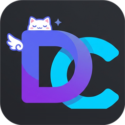
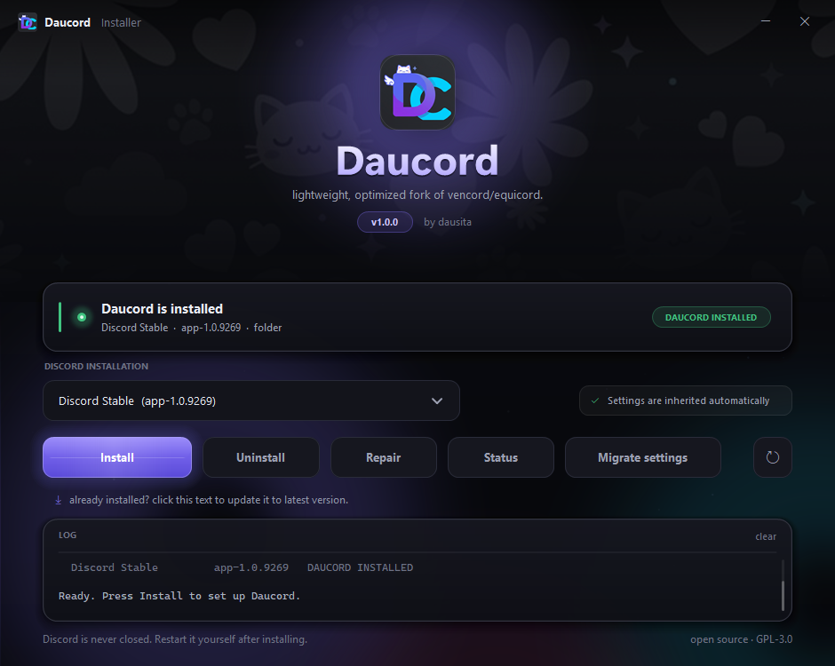

<p align="center">
  
</p>

# Daucord

Daucord is a Discord client mod forked from [Vencord](https://github.com/Vendicated/Vencord). It keeps Vencord's plugin system and adds a few things on top: bundled themes, a low-resource mode, a small clock widget, its own icons, and a Windows installer that also knows how to update itself.

Everything here is GPL-3.0 and the source is in this repository. The desktop build is minified by esbuild, not obfuscated.

## Running it

Grab `DaucordInstaller.exe` from the Releases page, run it and choose Install. Restart Discord yourself when it finishes. The installer never closes Discord on its own.

You need Windows 10 or 11 and the Discord desktop app (Stable, PTB, Canary or Development). Nothing else. The exe carries its own payload and uses the .NET Framework that already ships with Windows, so there is no Node.js, no admin prompt and no internet connection needed during installation.

If Vencord or Equicord is already installed, their injector is moved to `app.asar.backup-<timestamp>` and the untouched Discord file is kept as `_app.asar`. Uninstall puts the original back.



The GUI has Install, Uninstall, Repair, Status and Migrate settings, plus one link at the bottom: "already installed? click this text to update it to latest version." That link reapplies the build bundled in the exe, checks GitHub for a newer release, verifies its SHA-256 and runs the newer installer quietly if there is one.

The CLI version takes the same operations:

```bat
DaucordInstallerCli.exe status --branch all
DaucordInstallerCli.exe install [--branch all] [--dry-run]
DaucordInstallerCli.exe repair
DaucordInstallerCli.exe uninstall [--force]
DaucordInstallerCli.exe migrate [--from <path>]
DaucordInstallerCli.exe install --discord-dir "D:\Discord"
```

Both executables are built with the `csc.exe` that comes with Windows. To build them yourself, run `pnpm build` followed by `pnpm buildInstaller`.

## Settings from Equicord or Vencord

Daucord stores its data in `%APPDATA%\Daucord`, while Equicord and Vencord use their own folders. Installing Daucord does not touch theirs.

On first install, if Daucord has no settings yet, the installer copies `settings.json`, `quickCss.css`, `native-settings.json` and the files in `themes/` from Equicord or Vencord. Source files are only read. If Daucord settings already exist they are backed up as `settings.json.bak-<timestamp>` before anything is overwritten. You can trigger the same copy any time from the installer button or with `DaucordInstallerCli.exe migrate`.

Settings for Equicord-only plugins are ignored, since those plugins do not exist here.

## Updates

Daucord checks for a new build every time Discord starts. When a release with a higher version is published, you get a notification in Discord. Automatic updates are on by default: the files are downloaded, checked against the SHA-256 in the manifest and written to `%APPDATA%\Daucord\dist`. A second notification then asks you to restart, and Discord only restarts after you click it. Manual updates live in Settings, under Daucord and then Updater, where the Update Now button asks for confirmation before restarting.

For a release to be picked up, bump the version in `package.json`, tag the commit as `v<version>` and publish a GitHub release. The release workflow attaches the dist files, the generated manifest and the installer executables. Pushing a commit without a release does not notify users.

## Plugins

All Vencord plugins are present, along with nine Daucord ones:

| Plugin | What it does | Default |
| --- | --- | --- |
| DaucordPerf | Turns off animations and effects that cost CPU/GPU and memory | on |
| DaucordThemes | Five built-in themes that apply without a restart | on, theme: None |
| DaucordClock | Draggable clock widget that remembers its position | off |
| DaucordMessageTools | Adds "Copy Creation Time" to the message context menu | on |
| GlobalBadges | Shows cross-mod profile badges from the GlobalBadges service to users who have the plugin | off |
| DaucordWaterReminder | Draggable water reminder with interval, desktop notification and custom sound settings | off |
| DaucordBadgeChanger | Client-side badge picker for your own profile, 79 presets plus a custom image and tooltip | off |
| DaucordSpotifyLyrics | Apple Music style lyrics for Spotify: embeds into the player, or click it to open an enlarged draggable window with cover art and playback controls; word synced lyrics from NetEase, line synced from LRCLIB or QQ Music, persistent cache, timing offset and a clock that stays in sync across pause and track changes | off |
| DaucordSnowy | Winter theme with lightweight canvas snowfall that keeps working when animations are disabled | off |
| AntiNickname | Automatically resets a nickname someone assigned to you in a server | off |
| DmReadReceipt | Shows a Seen indicator on your DM messages | off |

Another 297 plugins were adapted from [Endcord](https://github.com/Endcord/Endcord), which is also GPL-3.0. Fourteen Endcord plugins are still left out: they depend on Endcord's native binary module, FFmpeg/WASM or missing npm packages and would need a rewrite or extra dependencies to run here. You can find the ported ones under `src/plugins`. Plugin settings are in the Daucord section of Discord's settings.

Endcord header bar buttons are mapped to Vencord's chat bar buttons, so ported plugins that used them remain usable instead of having invisible controls.

The NEW badge now follows plugin code: it appears on first launch for genuinely new plugins and after an update only for plugins whose code actually changed.

## Themes

Pick one of the five built-in themes in the DaucordThemes plugin. They recolour Discord's current CSS variables live, so there is no restart. QuickCSS and online theme links work as they do in Vencord, and the raw CSS files are in `themes/`.

## Branding

The logo source is `branding/daucord-logo.svg`, with PNG sizes from 16 to 1024 and a multi-size `daucord.ico` next to it. To regenerate the icon set:

```bat
powershell -ExecutionPolicy Bypass -File branding/make-icons.ps1
```

## Building from source

```bat
pnpm install --frozen-lockfile
pnpm build --dev
pnpm test:ts
pnpm lint
```

The output goes into `dist/`, which is where the installer reads `patcher.js` from. `dist/SHA256SUMS.txt` holds the checksums of the packaged installers.

## Security

See [SECURITY.md](SECURITY.md). Short version: no telemetry, no obfuscated code, the installer does not manage Discord processes, and updates are verified before they are applied.

## Licence

GPL-3.0-or-later, same as Vencord. Vencord's copyright headers are preserved: Vencord, Copyright (c) 2022 Vendicated and contributors. Daucord changes, Copyright (c) 2026 Daucord contributors.

Discord is a trademark of Discord Inc. This project is not affiliated with Discord Inc. Client mods may violate Discord's Terms of Service; use at your own risk.
